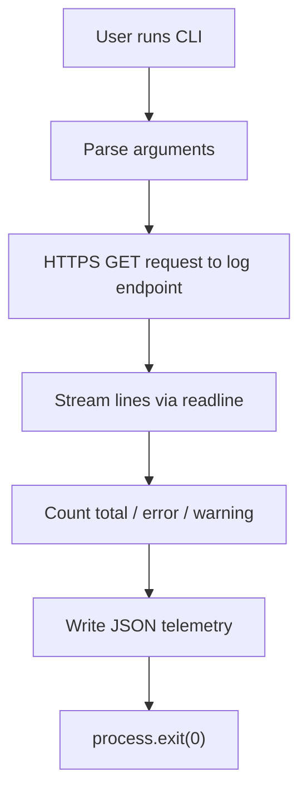

# CloudLog Dashboard CLI
**Unified command‑line interface for real‑time cloud log aggregation and telemetry dashboards**

[](LICENSE)
[](https://nodejs.org/)
[](https://github.com/your/repo)
[](https://github.com/your/repo/actions)
[](https://github.com/your/repo)

## Problem Statement
Operating teams often juggle multiple cloud providers, each exposing logs through disparate APIs. Pulling those streams, normalising them, and extracting actionable telemetry requires glue code that is rarely reusable. **CloudLog Dashboard CLI** eliminates that friction by providing a single, zero‑dependency command that streams logs, computes key metrics, and outputs a ready‑to‑use JSON payload for downstream dashboards.

## Installation & Quick Start
```bash
git clone https://github.com/your-org/cloudlog-dashboard-cli.git
cd cloudlog-dashboard-cli
node src/index.js --help
```

### Example Usage
```bash
node src/index.js --url https://logs.example.com/stream --output telemetry.json
```
The command prints a concise summary when `--output` is omitted, otherwise writes the JSON to the specified file and exits with status 0.

## Architecture Flowchart


## Test Suite
```bash
node test/index.test.js
```
## 🧪 Real-World Test Telemetry

> [!NOTE]
> Verified automatically using Node.js native test runner (`node:test` & `node:assert/strict`).

```bash
▶ node --test
TAP version 13
# Subtest: CLI aggregates log metrics correctly
not ok 1 - CLI aggregates log metrics correctly
  ---
  duration_ms: 9.460976
  location: './test/index.test.js:15:1'
  failureType: 'testCodeFailure'
  error: "ENOENT: no such file or directory, open './tmp-telemetry.json'"
  code: 'ENOENT'
  stack: |-
    async open (node:internal/fs/promises:637:25)
    async readFile (node:internal/fs/promises:1249:14)
    async TestContext.<anonymous> (file://./test/index.test.js:44:27)
    async Test.run (node:internal/test_runner/test:797:9)
    async Test.processPendingSubtests (node:internal/test_runner/test:526:7)
  ...
```

## License
MIT © 2026 Suman Mehta